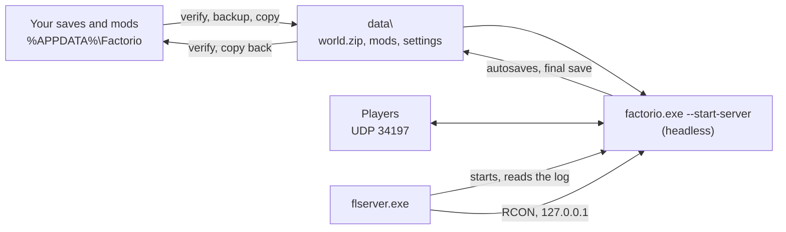

# How it works

[Русский](../ru/architecture.md) · [Docs](../README.md)

## Overview

flserver does not simulate a factory. It starts `factorio.exe` of your installation in the mode the game has for dedicated servers (`--start-server`), which has no window, graphics or sound, and looks after everything around that process.

## Why the game's engine is still needed

The server is the authority of the game: it computes every tick of the whole map, and clients check themselves against it each tick. Any difference in the result disconnects the player. Replacing the engine would mean reproducing the closed-source simulation exactly, down to rounding, which is not realistic. The official dedicated server is the same engine without the graphics; flserver runs that engine from the game you already own, which also means that the version always matches the game and no second download is needed.

What flserver changes is the memory: 340 to 380 MB on the Space Age test map, because graphics and textures are not loaded.

## Starting

1. Read `flserver.json`; on the first run find the game and write the file.
2. If a session was interrupted, recover it ([Saves](saves.md#crash-recovery)).
3. Check the save, the disks and the port. The port is checked in the system's UDP table and not by opening a socket, so Windows does not show a second firewall question for `flserver.exe`.
4. Back up the save, copy it to `data\world.zip`, sync mods, write `config.ini`.
5. Start `factorio.exe` with the data folder as its user folder, the server settings, and an RCON port: a free local port with a random password.
6. Write `data\session.json` (process id, RCON port and password, the original save and its size and time, the start time).
7. Read the game's output. The line `Starting RCON interface` means the map is loaded and the server is up.

## Controlling

Everything the console, `status`, `cmd`, `stop` and the idle check do goes through RCON, Factorio's remote console, over `127.0.0.1`. Each command opens its own short connection, so nothing can leave one hanging. `status`, `cmd` and `stop` from another window read the port and password from `session.json`.

## Stopping

1. `/quit` over RCON. The game saves the map into `world.zip` and shuts down the network.
2. When the log shows that the connection state is `Closed`, the map is written and the clients are gone. On Windows `factorio.exe` often does not exit after that by itself, so flserver ends the process after a short wait. This loses nothing: the state is already on disk.
3. The newest intact save of this session goes back to the game ([Saves](saves.md#when-it-stops)) and `session.json` is deleted.

If the game does not reach step 2 within two minutes, or does not start within five, the process is ended and the same recovery logic runs on whatever was saved.

## Why the process is not tied to the console window

flserver starts the game with no console of its own and in its own process group. Ctrl+C then reaches only flserver, which stops the game properly through RCON instead of the game being cut in the middle of a save.

## Checked behaviour

The behaviour was tested end to end against a copy of a real Space Age save with the real game: start and stop; stopping from another window; the original changed during the session; an autosave as the original; killing flserver and the game and recovering on the next start; stopping a server whose window is gone; a busy port; a damaged and a fake save; and the idle shutdown. The save logic (verification, choice of the newest intact save, the cases where the original is kept, backups, mod sync) and the RCON framing also have unit tests: `go test ./...`.

## Limits

- Windows only. The Windows-specific parts are in `windows.go` (processes, the registry, the UDP table, memory, the console).
- One server at a time per folder.
- Mods as unpacked folders are not copied.
- The server runs under your Windows user, and the RCON password is readable from `data\session.json` by that user.
- It has been tried on Factorio 2.0.72. Other 2.0.x versions should work, since flserver only uses documented command-line options and RCON, but they are untested.
