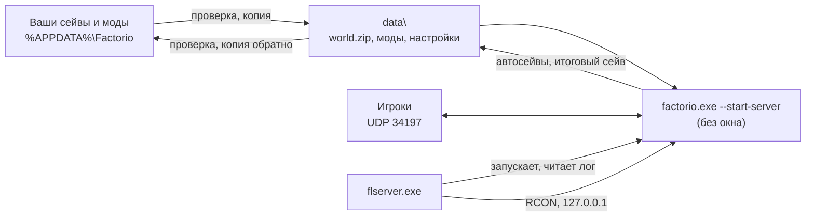

# Как это устроено

[English](../en/architecture.md) · [Документация](../README.md)

## Общая схема

flserver не моделирует фабрику. Он запускает `factorio.exe` вашей установки в режиме, который в игре есть для выделенных серверов (`--start-server`) и в котором нет ни окна, ни графики, ни звука, и следит за всем вокруг этого процесса.

## Почему движок игры всё равно нужен

Сервер — главный в игре: он считает каждый тик всей карты, а клиенты на каждом тике сверяются с ним. Любое расхождение в результате отключает игрока. Заменить движок значило бы в точности воспроизвести закрытую симуляцию, вплоть до округлений, и это нереально. Официальный выделенный сервер — тот же движок без графики; flserver запускает этот движок из уже имеющейся у вас игры, поэтому версия всегда совпадает с игрой и второй загрузки не нужно.

Меняется потребление памяти: 340–380 МБ на тестовой карте Space Age, потому что графика и текстуры не загружаются.

## Запуск

1. Читается `flserver.json`; при первом запуске находится игра и файл создаётся.
2. Если прошлая сессия была прервана, она восстанавливается ([Сохранения](saves.md#восстановление-после-сбоя)).
3. Проверяются сейв, диски и порт. Порт проверяется по системной таблице UDP, а не открытием сокета, поэтому Windows не задаёт второй вопрос брандмауэра про `flserver.exe`.
4. Делается копия сейва, он копируется в `data\world.zip`, синхронизируются моды, пишется `config.ini`.
5. Запускается `factorio.exe` с папкой data в качестве пользовательской, настройками сервера и портом RCON: свободный локальный порт и случайный пароль.
6. Пишется `data\session.json` (id процесса, порт и пароль RCON, исходный сейв с его размером и временем, время запуска).
7. Читается вывод игры. Строка `Starting RCON interface` означает, что карта загружена и сервер работает.

## Управление

Всё, что делают консоль, `status`, `cmd`, `stop` и проверка простоя, идёт через RCON, удалённую консоль Factorio, по `127.0.0.1`. Каждая команда открывает своё короткое соединение, так что ничто не может остаться висеть. `status`, `cmd` и `stop` из другого окна берут порт и пароль из `session.json`.

## Остановка

1. `/quit` по RCON. Игра сохраняет карту в `world.zip` и закрывает сеть.
2. Когда в логе состояние соединения становится `Closed`, карта записана и клиентов уже нет. В Windows `factorio.exe` после этого часто не завершается сам, поэтому flserver после короткой паузы завершает процесс. Это ничего не теряет: состояние уже на диске.
3. Самый новый целый сейв этой сессии возвращается в игру ([Сохранения](saves.md#когда-сервер-останавливается)), а `session.json` удаляется.

Если игра не доходит до шага 2 за две минуты или не запускается за пять, процесс завершается, и та же логика восстановления работает с тем, что успело сохраниться.

## Почему процесс не привязан к окну консоли

flserver запускает игру без собственной консоли и в отдельной группе процессов. Тогда Ctrl+C доходит только до flserver, и он останавливает игру правильно, через RCON, а не обрывает её посреди сохранения.

## Проверенное поведение

Поведение проверено от начала до конца на копии настоящего сейва Space Age с настоящей игрой: запуск и остановка; остановка из другого окна; оригинал, изменённый за время сессии; автосейв в роли оригинала; завершение flserver и игры принудительно и восстановление при следующем запуске; остановка сервера, окна которого уже нет; занятый порт; повреждённый и поддельный сейв; остановка простаивающего сервера. Логика сейвов (проверка, выбор самого нового целого сейва, случаи, когда оригинал сохраняется, копии, синхронизация модов) и формат пакетов RCON покрыты и юнит-тестами: `go test ./...`.

## Ограничения

- Только Windows. Всё, что завязано на Windows, лежит в `windows.go` (процессы, реестр, таблица UDP, память, консоль).
- Один сервер за раз на папку.
- Моды в виде распакованных папок не копируются.
- Сервер работает от вашего пользователя Windows, и пароль RCON читается из `data\session.json` этим пользователем.
- Проверено на Factorio 2.0.72. Другие версии 2.0.x должны работать, потому что flserver использует только документированные параметры командной строки и RCON, но это не проверялось.
